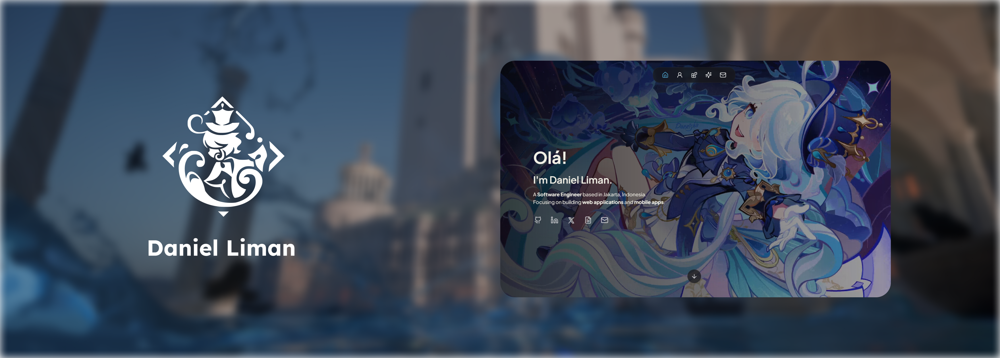

[](#)


# Portofolio Project ─ dnlmn-web

This is my portfolio website project, built with [Next.js](https://nextjs.org/) and [Tailwind CSS](https://tailwindcss.com/). I created this project as part of my journey into website development and to further explore the Next.js framework. Along the way, I also learned 3D modeling with [Blender](https://www.blender.org/) and integrated 3D models with animation into my site using the [Three.js](https://threejs.org/) library. There's still plenty of room for improvement, and I'll continue to work on it in the future!

Special credits to some assets I used in this website:
- Genshin Wiki [(Link)](https://genshin-impact.fandom.com/wiki/Furina/Gallery/)
- Lucide [(Link)](https://lucide.dev/)
- Furina MMD Model from 好想吃番茄味肥牛饭 [(Link)](https://www.aplaybox.com/details/model/e19BJnS8sZxH)
- Furina Looping Wallpaper from Darrisha [(Link)](https://youtu.be/04H14c1QERU)

### Recent Change

- (2026/01/18) Moved 3D Model from home page to 404 page and replace it with a video instead

<br>

## Project previews

All project cards, including Portfolio Website, are configured in `src/json/proj.json`.
To use an animated WebP or video preview:

1. Put the `.webp`, `.webm`, `.mp4`, or `.ogv` file in `public/images/projects/`.
2. Change that project's `imageUrl` in `src/json/proj.json`, for example:

   ```json
   "imageUrl": "/images/projects/moodtune.h264.mp4"
   ```

The card detects the file extension automatically. Videos autoplay muted, loop,
and play inline on mobile. WebP previews are served directly to preserve
animation. Existing PNG previews continue to work. The preview area uses a 16:9
crop, so use that aspect ratio to show the full image.

The five animated project previews use AV1 in MP4 first, with H.264 in MP4 as
the compatibility fallback. Each project's optional `videoSources` lists these
in preference order with codec MIME types; `imageUrl` points to its H.264 copy.
Browsers choose a supported source. AV1 alone does not cover older Apple devices,
even in MP4: [Safari requires an AV1 hardware decoder](https://webkit.org/blog/14445/webkit-features-in-safari-17-0/).

`public/images/projects/` contains only the current previews: five AV1 MP4s,
five H.264 MP4 fallbacks, and the two static PNGs for Ngawasin and Debt Circle.
Unused previews are archived by format under `assets/old-thumbnail/`:

- `images/` — previous static PNG thumbnails, including the unused Todos image.
- `webm/` — the five original VP9 videos used as conversion sources.
- `webp/` — previous animated WebP previews.

Both MP4 formats are in use; there are no unused MP4s to archive currently.
The archived files are outside `public/` and are not served by the website.

Regenerate both MP4s directly from each archived WebM into
`public/images/projects/`, without an intermediate AV1 WebM or chained encodes:

```bash
FFMPEG_PATH=/path/to/ffmpeg node artifacts/encode-project-previews.mjs
```

FFmpeg needs `libaom-av1` and `libx264`. The script preserves resolution and frame
rate, uses 8-bit `yuv420p`, drops audio for muted previews, and puts MP4 metadata
at the beginning for streaming. It writes file sizes to
`artifacts/project-previews/encoding.json`. Transcoding existing lossy files can
lose some detail; for future edits, encode from original scene frames when possible.

## Search metadata and hero assets

`src/lib/site.ts` defines the production URL (`https://www.dnlmn.dev`) and the
homepage's `ProfilePage`/`Person` JSON-LD. The homepage, blog index, and individual
articles declare their own canonical and Open Graph URLs. Update the profile
data when your public affiliations or social profiles change.

`/sitemap.xml` is generated from the homepage, blog index, and published MDX
articles. `public/robots.txt` links to it and retains the existing `/api/` rule.
After deployment, submit the sitemap and inspect the homepage in Search Console.
The existing Vercel domain redirects and Google verification token are retained.

The hero prefers `public/bg.av1.mp4` and falls back to the original H.264
`public/bg.mp4`. Its full-resolution poster is `public/bg_stop.webp`; the
original PNG remains available as the conversion source. Both new assets keep
the original 3840 × 2160 dimensions, and the video retains 30 fps and its full
duration. Regenerate with an FFmpeg build containing `libaom-av1`:

```bash
FFMPEG_PATH=/path/to/ffmpeg node artifacts/hero-optimization/optimize.mjs
```

Conversion settings, size and quality measurements, and visual comparisons are
in `artifacts/hero-optimization/`. Compression is lossy; the originals are kept
for future exports.

## ⚙️ Development Setup

To run the project in your local workspace, configure the `.env.local` file to set up enviroment variable and secrets. You can use the `.env.example` template that I put in the root directory.

```.env
# Spotify API
SPOTIFY_CLIENT_ID=xxxx
SPOTIFY_CLIENT_SECRET=xxxx
SPOTIFY_REFRESH_TOKEN=xxxx

# EmailJS
EMAILJS_SERVICE_ID=xxxx
EMAILJS_TEMPLATE_ID=xxxx
EMAILJS_PUBLIC_KEY=xxxx
EMAILJS_PRIVATE_KEY=xxxx
```
Kindly sets your own Spotify API App on the [Spotify Developer](https://developer.spotify.com/) dashboard and [Email.js](https://www.emailjs.com/) account for emailing system.


After configurating the environment variable, install the required package with `npm` or `pnpm`,
```bash
npm install
#or
pnpm install
```

and finally, run the development version of the website using commands below:
```bash
npm run dev
# or
pnpm dev
```
(... or with the other package manager!)

Open [http://localhost:3000](http://localhost:3000) with your browser to see the result.
